### 👋 Olá! Eu sou o Abner

Venho do **audiovisual** e do **marketing digital** e hoje uso programação para automatizar o que faço no dia a dia.
Gosto de transformar ideias em ferramentas que eu mesmo uso, com cuidado no visual, porque design também conta.

- 🎬 **Vídeo e fotografia:** edição, cor e finalização (DaVinci Resolve, CapCut, câmeras Sony)
- 📈 **Marketing digital:** tráfego pago, criativos e atendimento automatizado
- 🤖 **Automação e IA:** bots, IA local e integrações que economizam tempo de verdade
- 🌱 **Aprendendo agora:** Python, desenvolvimento web e análise de dados com Power BI

 

## 🪐 Attas — meu centro de comando pessoal

  
    
  

 

Um assistente que roda no meu PC e que eu controlo de qualquer lugar: pelo **Telegram**, por um **painel web** no estilo *Liquid Glass* ou pelo celular.

| | |
|---|---|
| 💬 **Duas IAs, um assistente** | Uma IA local e gratuita (Qwen via Ollama) conversa e pesquisa na internet. Quando precisa agir no PC, o **Claude** assume. |
| 🛂 **Seguro por padrão** | PIN, aprovação por botões antes de qualquer ação importante e acesso remoto só pela minha rede privada. |
| 👀 **Tudo ao vivo** | Cada passo da IA aparece na tela enquanto ela trabalha: lendo arquivo, rodando comando, criando planilha. |
| 💸 **Finanças** | Lançamentos por texto, áudio ou foto do comprovante (OCR + IA local), BI próprio e integração com **Power BI**. |
| 🎵 **Hub do dia a dia** | Widgets editáveis, música tocando no PC, temas e papel de parede personalizáveis. |

🔒 Projeto pessoal em desenvolvimento ativo, com código privado.

 

## 🧰 Ferramentas

**Código**

**IA, dados e criação**

 

  Feito com ☕, curiosidade e uma boa ajuda de IA · <b>abnerux</b>

